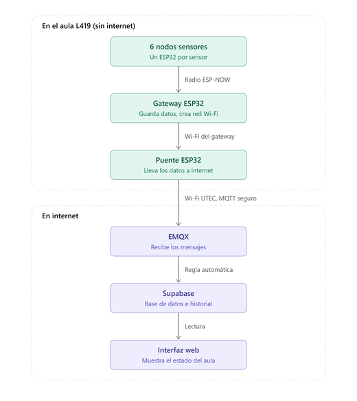
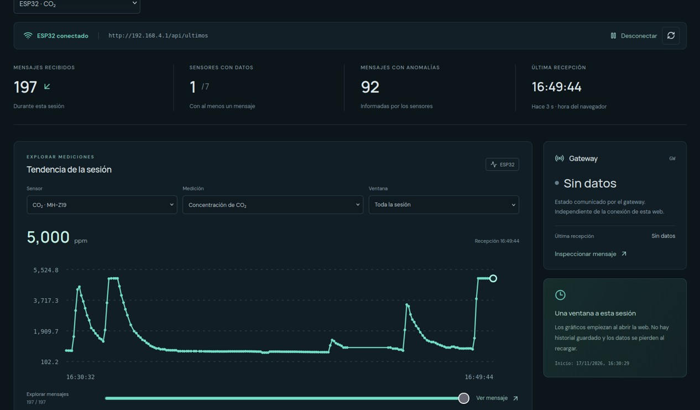
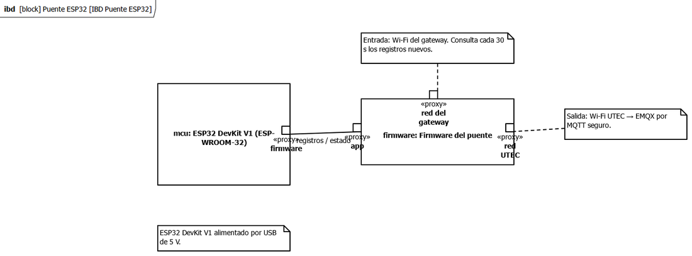

**Status: in development.** A working prototype of the IoT layer of a digital twin for classroom L419 at UTEC. Six ESP32 sensor nodes measure the room in real time and the readings are stored locally and in the cloud. Permanent installation, on-site calibration, analytics and prediction are still pending.

### My role

Interdisciplinary team project of four students (Electronics, Computer Science and Mechatronics). My main responsibilities:

- Sensors and firmware: adapted the node and shared-gateway firmware (base code by another team in the course) and wrote the cloud bridge.
- Communications (ESP-NOW, Wi-Fi/HTTP, MQTT over TLS) and, together with the dashboard developer, the integration with EMQX and Supabase.
- Together with the mechatronics teammates, the cause → event → effect reasoning graphs and the SysML model in Gaphor (30 diagrams, 31 technical requirements, 9 test cases), following the NASA Systems Engineering Handbook.

### Measured variables

| Node | Sensor | Measures |
|---|---|---|
| 1 | MH-Z1911A (NDIR, UART) | CO₂ in ppm and alert level |
| 2 | INMP441 (I²S) | Noise level, impacts, sustained noise |
| 4 | BH1750 (I²C) | Illuminance and lights switching |
| 5 | MLX90640 32×24 (I²C) | Entries, exits and estimated occupancy |
| 6 | KY-024 Hall sensor (ADC) | Door open/closed and time open |
| 7 | BME280 (I²C) | Temperature, humidity, pressure |

Each node computes averages and anomalies (for example low illuminance or door open too long) before sending a binary packet with a common 11-byte header.

### Data pipeline

The nodes send packets over ESP-NOW to an ESP32 gateway that stores them in flash as numbered JSON records and serves them over its own Wi-Fi network and an HTTP API. A second ESP32, the bridge, downloads new records every 30 s and publishes them to EMQX Serverless over MQTT/TLS; an EMQX rule writes each message to Supabase (PostgreSQL), where the web dashboard reads it.

The gateway is shared by every team in the course, so the internet uplink lives in a separate bridge instead of in the gateway. Other teams keep local access to the data, and if the cloud link fails the gateway keeps recording. The cost is one more ESP32 and 30–60 s of latency.

### Results so far

All six sensors were tested. An end-to-end test (BH1750 → MQTT) delivered one message every 5 s with no losses, and the gateway stored 2,849 records with none dropped. The data reached EMQX and the remote dashboard.

### Next steps

Fix the bridge stalls with large batches (TLS runs out of memory), install and calibrate the nodes in the room, and add a predictive model to anticipate abnormal conditions.

**Tech:** ESP32, ESP-NOW, MQTT/TLS, EMQX, Supabase/PostgreSQL, SysML/Gaphor.
