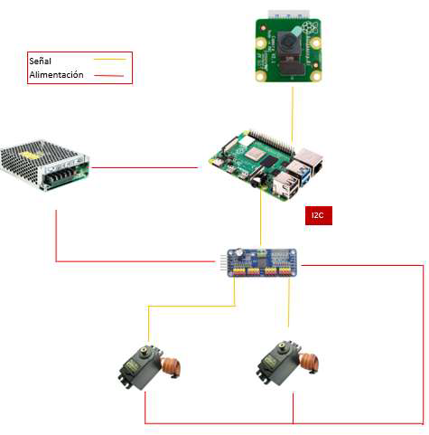
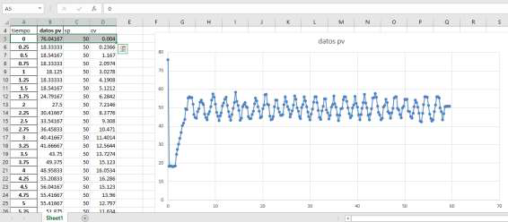
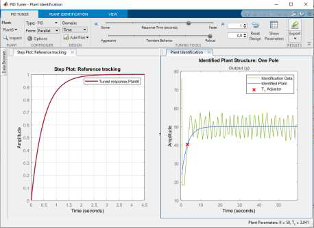

A two-axis pan–tilt camera on a Raspberry Pi that keeps a face centered in the image, built as a first step towards a camera gimbal. I followed a classic control workflow: collect open-loop data, identify the plant, tune a controller, close the loop and evaluate.

### Hardware

Raspberry Pi, Pi Camera, two MG995 servos, a PCA9685 PWM driver over I²C, and a 5 V / 3 A supply.

### System identification

An open-loop script moved the pan servo while logging, every 0.25 s, the setpoint, the control signal and the measured face position (OpenCV Haar cascade). I loaded the data in MATLAB, identified a first-order plant (K = 50, T = 3.04 s) and tuned the controller with PID Tuner.

### Closed-loop control

Each axis runs a discrete PID in incremental form, u[k] = u[k−1] + q₀e[k] + q₁e[k−1] + q₂e[k−2], with Ts = 0.25 s, Kp = 0.122, Ti = 0.3 s and Td = 0 (in practice a PI controller). The output is saturated to 0–100% and mapped to the servo pulse range.

### Results

The camera oscillated around the face instead of settling, so it was not stable enough for a gimbal. The likely causes are:

- the loop runs at only 4 Hz, and face detection adds latency, which reduces the phase margin;
- the face center from the Haar detector is noisy between frames;
- the model was identified on the pan axis only, but the same gains were used for tilt;
- the MG995 servos have deadband and backlash.

### Next version

A faster loop with a better detector (MediaPipe), a Kalman filter on the face position to reduce noise and compensate the delay, and a state-space model per axis with an LQR (or LQG) controller, compared against the PID with the same metrics.
