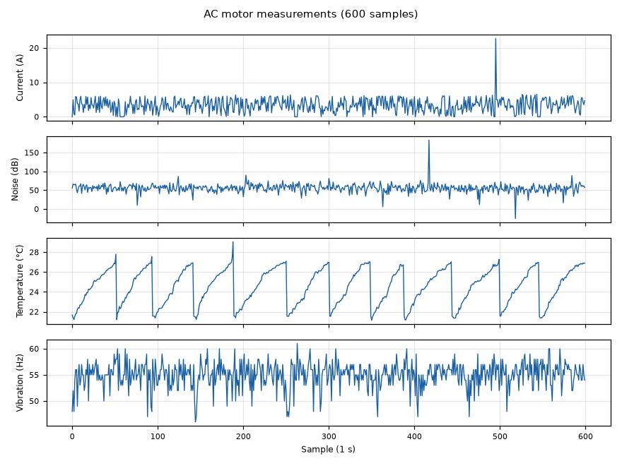

Most motor failures show early signs: higher current, overheating, more vibration or noise. This system logs those variables continuously from an AC motor and sends them to the cloud, as the basis for predictive maintenance.

### Measurements

| Variable | Sensor and method |
|---|---|
| Current | Current transformer (30 A / 1 V) on an ADS1115 differential input, RMS over 1 s |
| Temperature | MLX90614 infrared sensor |
| Vibration | Vibration sensor on the ADS1115, pulses counted over 1 s |
| Noise | Microphone on the ADS1115, peak-to-peak converted to dB |

An Arduino samples the sensors and, using a Timer1 interrupt every second, sends the four values to a Raspberry Pi over serial. A second version reads the sensors directly from the Raspberry Pi over I²C. Each variable is published to its own MQTT topic and stored in IBM Cloud through Node-RED.

### Dataset

The repository includes 600 one-second samples recorded from the motor.

### Next steps

Label normal and faulty operation (overload, imbalance, bearing wear), replace pulse counting with a vibration spectrum (FFT), and train an anomaly-detection model on the data.
