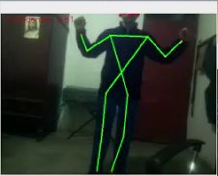
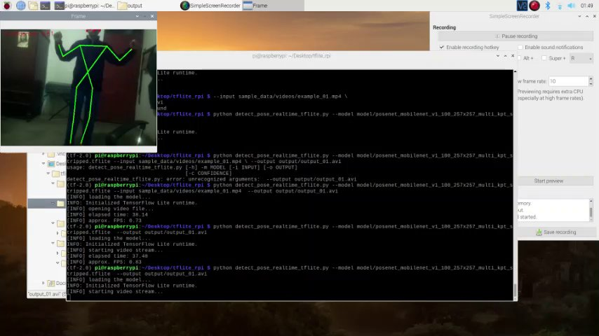

Real-time human pose estimation running entirely on a Raspberry Pi with TensorFlow Lite and a PoseNet (MobileNet v1) model, without a GPU.

The test recording in the repository shows the detected skeleton on a live camera feed and the TensorFlow Lite runtime logs on the Raspberry Pi.
