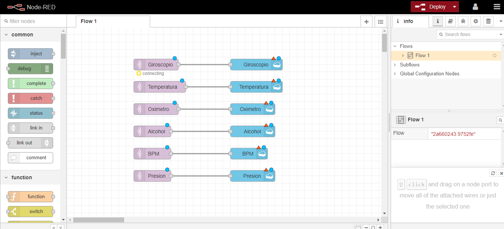
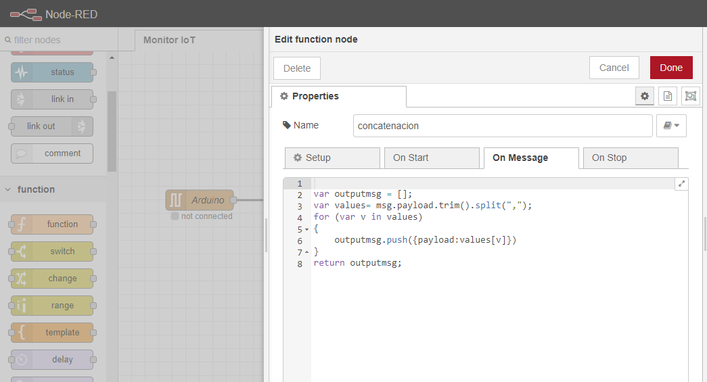
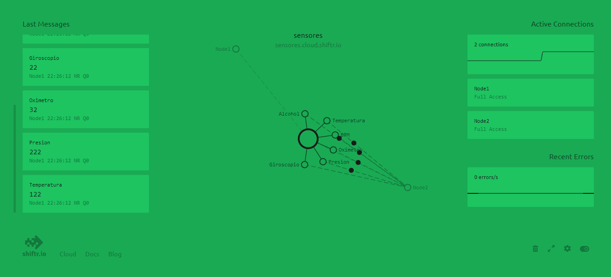

A prototype to monitor a person remotely: an Arduino measures several physiological signals and posture, and the data is published over MQTT and stored in the cloud.

### Measured signals

| Signal | Sensor |
|---|---|
| SpO₂ and heart rate | MAX30102 (I²C) |
| Body temperature | MLX90614 infrared (I²C) |
| Posture (standing / lying) | MPU6050, yaw–pitch–roll from its DMP |
| Breath alcohol | MQ-3 (analog) |
| Lung pressure | Differential pressure sensor, 100-sample moving average converted to mmHg |

### Data pipeline

The firmware prints one comma-separated line per cycle at 115200 baud. A local Node-RED flow reads the serial port, splits the line into six topics and publishes them to an MQTT broker (shiftr.io) and to IBM Watson IoT Platform. A second flow in the cloud subscribes to the topics and stores each signal in an IBM Cloudant database.

### Next steps

Move the acquisition to an ESP32 so the device publishes over Wi-Fi by itself, add alarms for low SpO₂ or fever, and calibrate the alcohol and pressure conversions against reference instruments.
